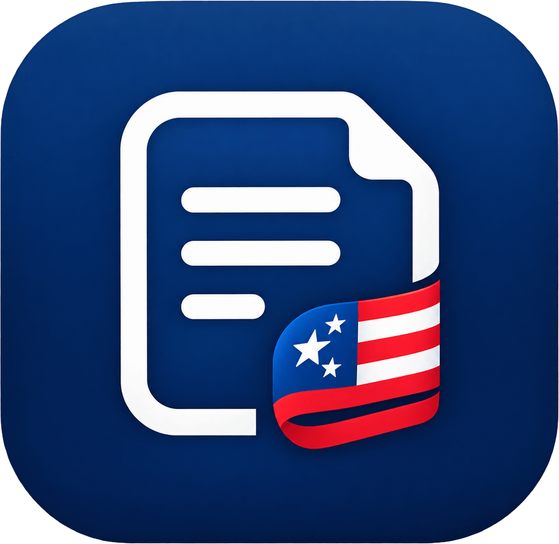
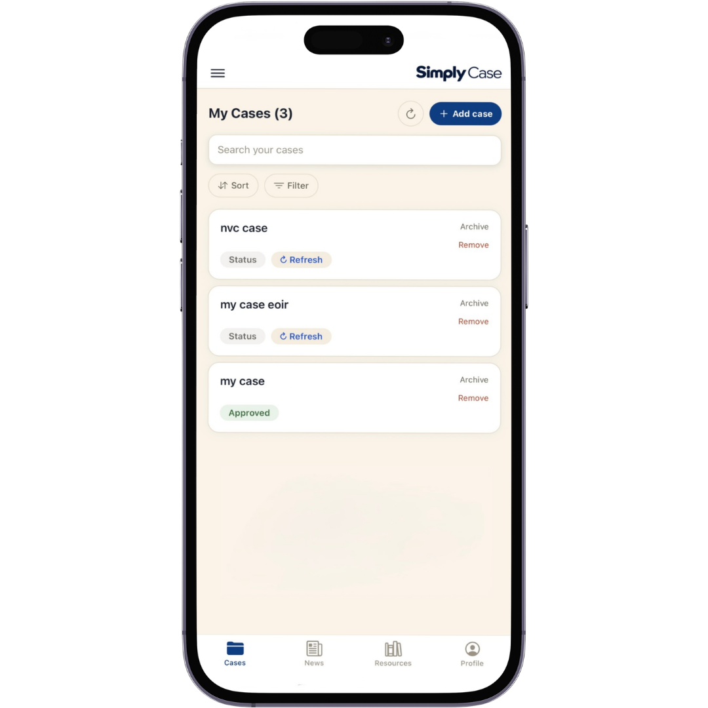
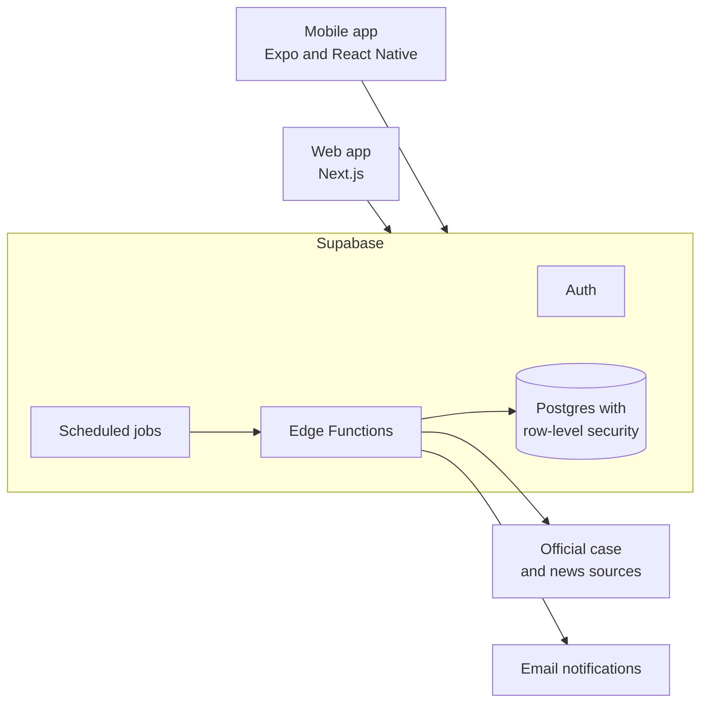

  

<h1 align="center">Simply Case</h1>

  One place to track your immigration cases, so you don't have to keep checking government websites.

  <a href="https://jakarallc.com/simplycase">Website</a> ·
  <a href="https://jakarallc.com/simplycase/privacy">Privacy</a> ·
  <a href="https://jakarallc.com/simplycase/terms">Terms</a> ·
  <a href="https://jakarallc.com/contact">Contact</a>

> This repository is a project overview. The source code is private because the app handles sensitive personal information.

  

## The problem

Immigration cases often span several government agencies, and each one has its own website and case number format. Checking them by hand is slow, and an important update is easy to miss.

## What it does

- **Tracks cases from different agencies in one list:** USCIS, visa cases (NVC and DS-160), and immigration court (EOIR).
- **Checks USCIS cases automatically** and emails you when a status changes.
- **Refreshes visa and court cases on your phone** when you ask, because those sources have to be read on the device.
- **Explains each status** with a simple label you can scan at a glance.
- **Keeps you informed** with immigration news and links to official resources.
- **Leaves you in control** with per-case notification settings, quiet hours, and account deletion from inside the app.

## How it's built

| Area | Tools |
|---|---|
| Mobile | Expo, React Native, Expo Router, TypeScript |
| Web | Next.js, React, TypeScript |
| Backend | Supabase Auth, Postgres, Edge Functions, scheduled jobs |
| Email | Resend |
| Quality | Node test runner, ESLint, GitHub Actions |
| Project setup | npm workspaces, with code shared between the apps |

## Engineering highlights

- **Privacy by design:** row-level security limits each account to its own data, and policies live in one public place, so the website and app can't disagree.
- **Monitoring that doesn't share the failure it watches for:** after an outage went unnoticed, I added a watchdog that runs inside the database, so it still raises an alert when background functions can't reach it.
- **Careful with outside services:** background checks handle a source's closed hours without treating them as case errors, and repeated failures on one case stop it from being retried endlessly.
- **Consent that means something:** when a policy changes, users are asked to agree again rather than being treated as agreeing because they kept using the app.
- **Safe everyday changes:** the main branch is protected, every change goes through a pull request, and automated checks run before it merges.

## Status

Simply Case is in active development ahead of its public release. It is built and run by [Jakara LLC](https://jakarallc.com).

## Disclaimer

Simply Case is an independent service. It is not affiliated with or endorsed by USCIS, the U.S. Department of State, EOIR, or any government agency, and it does not provide legal advice.

© Jakara LLC. All rights reserved.
